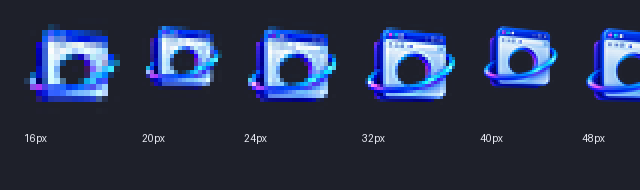

<div align="center">



# 小窗浏览器 · Mini Window Browser

**让网页随手可见，让工作与娱乐自由切换。**

一款基于 **Win32 + Microsoft Edge WebView2** 的 Windows 桌面悬浮浏览器。  
网页置顶、鼠标穿透、场景预设、媒体快捷键——让参考资料、视频与常用网页自然融入多任务桌面。

[](https://github.com/azurplain/Mini-Window-Browser/releases/latest)
[](https://github.com/azurplain/Mini-Window-Browser/releases)
[](https://www.microsoft.com/windows)
[](https://developer.microsoft.com/microsoft-edge/webview2/)
[](LICENSE.txt)

**[下载正式版](https://github.com/azurplain/Mini-Window-Browser/releases/latest)** · [查看使用说明](用户手册.md) · [更新日志](CHANGELOG.md) · [反馈问题或建议](https://github.com/azurplain/Mini-Window-Browser/issues)

</div>

---

## 不只是一扇游戏小窗

小窗浏览器最初诞生于游戏时查看攻略、地图和视频的需求，如今也适合日常工作、学习、创作与娱乐。

它并不打算替代完整的桌面浏览器，而是提供一块**可以随时唤出、固定位置、快速让出鼠标操作的网页空间**。无需在多个大窗口之间反复切换，就能把需要随时参照的信息留在眼前。

### 可以怎么用？

| 场景 | 小窗能帮你做什么 |
| --- | --- |
| **办公与多任务** | 将网页资料、帮助文档、在线面板等悬浮在主工作窗口旁，边操作边查阅 |
| **学习与创作** | 边阅读教程、课程或网页资料，边在笔记、编辑器和创作软件中实践 |
| **视频与音乐** | 把视频、直播或播放器放在桌面一角，配合媒体快捷键控制播放 |
| **游戏辅助** | 查看攻略、地图与视频；需要操作游戏时用圆形挖孔穿透或移入自动隐藏 |

## 核心功能

<table>
<tr>
<td width="50%" valign="top">

### 🗔 桌面悬浮与灵活布局

窗口置顶、拖动缩放、边缘吸附、无缝最大化；支持系统托盘与一键隐藏／恢复，把网页放在顺手的位置。

</td>
<td width="50%" valign="top">

### ◉ 鼠标穿透与沉浸显示

**圆形挖孔**让鼠标附近的区域透明并穿透点击；**整体透明／移入隐藏**适合保留完整网页画面又不遮挡操作。可调挖孔半径和刷新间隔。

</td>
</tr>
<tr>
<td valign="top">

### ▣ 一键场景预设

保存窗口位置与大小、标签列表、沉浸样式、网页缩放、快捷键等常用设置。不同任务、显示布局之间快速切换。

</td>
<td valign="top">

### ⌨ 自定义快捷键

键盘组合、鼠标中键和侧键均可绑定；支持一键隐藏、切换沉浸模式、播放／暂停、快进／快退、上一集／下一集。输入文字时可暂停全局热键，减少误触。

</td>
</tr>
<tr>
<td valign="top">

### ▶ 网页与媒体辅助

基于 WebView2 打开常见网站，提供标签页、书签、固定网页缩放（25%–500%），并对部分视频网站提供媒体控制兼容支持。

</td>
<td valign="top">

### 🛠 故障恢复与运行日志

标签栏右键可手动重建网页视图；新增或切换标签后的响应检测等待时间可调。运行事件按天记录，旧日志可设置保留 3／7／30 天或关闭自动清理。

</td>
</tr>
</table>

### 两种沉浸方式有什么区别？

| | 圆形挖孔模式 | 整体透明／移入隐藏模式 |
| --- | --- | --- |
| 显示 | 网页画面仍在，**鼠标周围形成透明圆孔** | 保留完整窗口画面，按设置控制透明度 |
| 操作 | 圆孔区域穿透点击后方程序 | 鼠标移入小窗时自动隐藏，方便操作后方程序 |
| 调整 | 挖孔半径、跟随刷新间隔（10–100ms，默认16ms） | 整体透明度 |
| 用途 | 需要边看边操作的文档、视频、游戏等 | 不希望小窗持续挡住操作的桌面多任务 |

默认按 **`0`** 切换沉浸模式，按 **`9`** 隐藏或显示窗口。快捷键可自行修改。

## v1.4.6 正式版更新

- **地址栏 Ctrl+A 全选修复：** 修复原生地址栏不能使用 `Ctrl+A` 全选网址的问题，同时避免可能出现的系统提示音。感谢 [Floatingcloud01](https://github.com/Floatingcloud01) 通过 [PR #27](https://github.com/azurplain/Mini-Window-Browser/pull/27) 提供修复。
- **兼容旧设置：** 本次仅为快捷键体验修复，原有的窗口布局、场景预设、日志、浏览器数据和 v1.4.5 功能保持不变。

## v1.4.5 主要功能回顾

- **网页异常恢复：** 新标签导航不再主动隐藏共享 WebView2；支持右键手动重建网页视图，以及可调的响应检查等待（3–30 秒，默认 5 秒）。自动检查不是每隔几秒强制刷新。
- **更顺畅的鼠标挖孔：** 刷新间隔可调（10–100ms，默认 16ms），修复部分不必要的重绘与文字布局遮挡。
- **可追踪的运行日志：** `config.ini` 同级的 `logs/` 记录启动、导航、WebView2 异常与恢复事件；默认自动保留 7 天，可选 3 或 30 天，也可关闭自动清理。
- **更便于使用：** 场景预设保存相关个性化设置，重写面向初次使用者的完整手册，发行包只附必要文件、许可证及三个空白快捷提示 TXT。

详细记录请查看 [CHANGELOG.md](CHANGELOG.md)。

## 快速开始

**系统要求：** Windows 10／11（推荐 x64），以及 [Microsoft Edge WebView2 Runtime](https://developer.microsoft.com/microsoft-edge/webview2/)。

1. 在 **[最新正式版](https://github.com/azurplain/Mini-Window-Browser/releases/latest)** 下载 `Mini-Window-Browser-v1.4.6-x64.zip`。
2. 完整解压到可写目录，确保 `XiaoChuang.exe` 和 `WebView2Loader.dll` 位于同一文件夹。
3. 双击 `XiaoChuang.exe`，按提示确认 Windows UAC。
4. 把小窗放到合适的位置，访问网页；按 `0` 体验鼠标穿透，或进入设置调整布局与快捷键。

**为什么启动会弹出 UAC？** 当前版本请求管理员权限，以改善与同样提升权限的游戏、程序之间的全局快捷键兼容性。因此每次运行都可能显示 UAC 提示。请只从可信来源获取软件。

### 默认快捷键

| 按键 | 操作 |
| :---: | --- |
| `0` | 进入／退出沉浸模式 |
| `9` | 隐藏／显示小窗 |
| 波浪号键（\` / ~） | 播放／暂停 |
| `5` | 快退；长按持续倒退 |
| `6` | 快进；长按临时加速 |
| `7` / `8` | 上一个／下一个视频（依网站支持情况） |

键盘按键、鼠标中键／侧键及每项快捷键的启用状态都可以在设置中调整。

## 使用前值得了解

- **共享网页视图：** 多个标签保存网址与标题，但当前版本共用一个 WebView2 控件；切换标签会重新导航，不能把它当作多个独立运行的后台网页。
- **窗口覆盖限制：** 真正的独占全屏程序可能绕过桌面合成；建议在游戏中使用无边框或窗口化全屏。
- **白屏仍可能发生：** 脚本响应检测无法识别所有图形合成异常。遇到网页持续空白时，可在标签栏右键选择“网页白屏 / 无法操作？重建网页视图”。
- **网站兼容性：** 播放器快捷键会受网站实现和页面变更影响，并非适配所有网页。

这些限制不会影响它作为日常网页悬浮辅助窗口的主要用途，也说明了它与完整桌面浏览器的区别。

## 设置、日志与隐私

- `config.ini`：保存窗口设置、书签、场景预设与标签信息。
- `XiaoChuang.exe.WebView2/`：WebView2 用户数据目录，通常包含缓存、Cookie 与网站登录状态。
- `logs/`：按 UTC 日期保存运行事件。点击“设置 → 打开日志文件夹”查看；日志**默认不记录**网址、搜索词、网页标题、输入内容、密码或 Cookie，也不会被小窗自动上传。
- 更换版本前请备份个人配置与 WebView2 数据；正式 ZIP 不包含任何开发者个人数据或测试缓存。

## 从源码构建

项目使用 **C++20 / Win32 / Microsoft Edge WebView2**，采用原生 Windows 桌面架构。

需要 Visual Studio 2022（安装“使用 C++ 的桌面开发”）、Windows 10/11 SDK，以及项目声明的 NuGet 依赖。

```powershell
git clone https://github.com/azurplain/Mini-Window-Browser.git
cd Mini-Window-Browser
msbuild .\小窗.slnx /m /t:Rebuild /p:Configuration=Release /p:Platform=x64
```

核心测试程序：`x64/Release/XiaoChuang.Tests.exe`。

主要模块在 `src/` 中，包括 `Application`、`WindowModeController`、`HotkeyManager`、`InputGuard`、`MediaBridge`、`ConfigStore`、`LogStore` 与 `WebViewZoom`。

## 文档与参与

- [使用说明](用户手册.md)：安装、窗口操作、场景预设、视频控制、日志与常见问题。
- [更新日志](CHANGELOG.md)：历次功能更新、修复和兼容性说明。
- [问题反馈与功能建议](https://github.com/azurplain/Mini-Window-Browser/issues)：反馈时建议附上复现步骤；需要日志时请先检查隐私。
- [第三方组件许可](THIRD_PARTY_NOTICES.txt)：WebView2 和 WIL 的相关声明。

欢迎为日常办公、学习、娱乐和游戏等真实场景提出建议。小窗浏览器会继续围绕**快捷、可控、不妨碍主任务的网页悬浮体验**改进。

## 开源许可

本项目以 [GNU GPL v3.0](LICENSE.txt) 许可开源。
